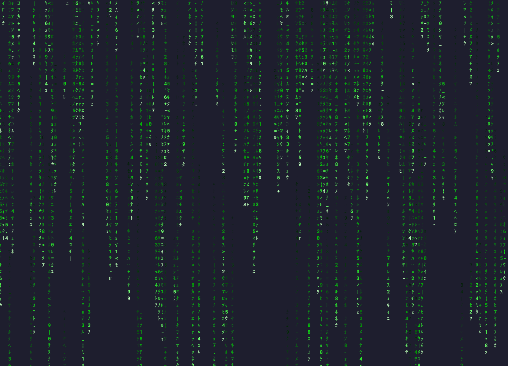

# matrox

Matrix-style digital rain (like `cmatrix`) whose intensity follows CPU/GPU load:
idle machine = light drizzle, busy machine = fast, dense, glitchy storm.

Runs in any terminal on Linux, macOS and Windows. No root / admin rights needed,
neither to build nor to run.

## Quick start

    cargo install --path .
    matrox

If you don't have `cargo` yet, or that didn't work, read on.

## Building from source (no Rust knowledge needed)

### 1. Install the Rust toolchain

Rust is installed per user, in your home directory, so no `sudo` is needed.

- **Linux / macOS**: the official installer, [rustup](https://rustup.rs):

      curl --proto '=https' --tlsv1.2 -sSf https://sh.rustup.rs | sh

  Accept the defaults, then open a new terminal (or run `source ~/.cargo/env`).
- **Windows**: download and run `rustup-init.exe` from <https://rustup.rs>.
- A per-user package manager (e.g. AppMan) also works, as long as it provides `cargo`.

Check that it works:

    cargo --version

You also need a C linker (`cc`). It is already there on most Linux machines and on macOS
(if not: `xcode-select --install`). On Windows, rustup offers to install it.

### 2. Get the code and build it

    git clone <repository-url> matrox     # or unpack the source archive
    cd matrox
    cargo build --release

The first build downloads the dependencies (internet access needed) and takes about
a minute. The program is then at `target/release/matrox` (`matrox.exe` on Windows):

    ./target/release/matrox

### 3. Install it (optional)

To be able to type just `matrox` from anywhere:

    cargo install --path .

This copies the program to `~/.cargo/bin/` (or `$CARGO_HOME/bin/`). If you then get
"command not found", add that folder to your `PATH`, for example in `~/.bashrc` or
`~/.zshrc`:

    export PATH="$HOME/.cargo/bin:$PATH"

### Update, uninstall

    git pull && cargo install --path .    # rebuild and reinstall after an update
    cargo uninstall matrox                # remove the installed program
    cargo clean                           # delete build files (target/ folder)

### Without NVIDIA support

NVIDIA GPU monitoring is on by default and does nothing if there is no NVIDIA driver.
To leave it out completely:

    cargo install --path . --no-default-features

## Usage

    matrox                  # green, driven by the higher of CPU and GPU load
    matrox -u -H            # load line on top + shift to red under load
    matrox -c rainbow -s cpu
    matrox --fixed 80       # pretend the load is 80%, for testing
    matrox --help           # all options

Keys while running:

| Key           | Action                                   |
|---------------|------------------------------------------|
| `q` / `Esc`   | quit                                     |
| `h`           | show / hide the load line                |
| `c`           | next color                               |
| `t`           | toggle shift-to-red under load           |
| `s`           | next load source (cpu, gpu, max, avg)    |
| `+` / `-`     | more / fewer drops                       |
| `space`       | pause                                    |

## Where the load comes from

- **CPU**: the `sysinfo` library (Linux, macOS, Windows, BSD).
- **NVIDIA GPU**: the driver's NVML library, loaded when the program starts.
- **AMD / some Intel GPUs on Linux**: `/sys/class/drm/card*/device/gpu_busy_percent`.

If no GPU can be read, the load line shows `GPU n/a` and the CPU drives the rain.

## Troubleshooting

- **Katakana show up as boxes or `?`**: your terminal font lacks Japanese characters.
  Install one (e.g. Noto Sans CJK), or use `matrox -C ascii`.
- **Colors look washed out or banded**: your terminal may not support 24-bit color.
  Try `matrox --colors 256`.
- **`linker 'cc' not found`** while building: install a C compiler (see step 1).
